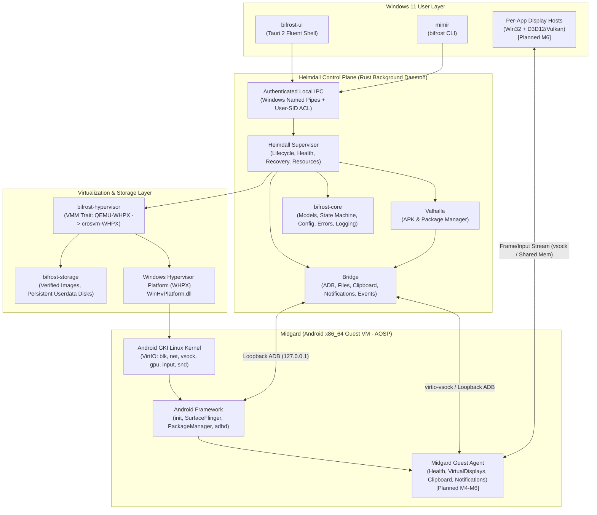
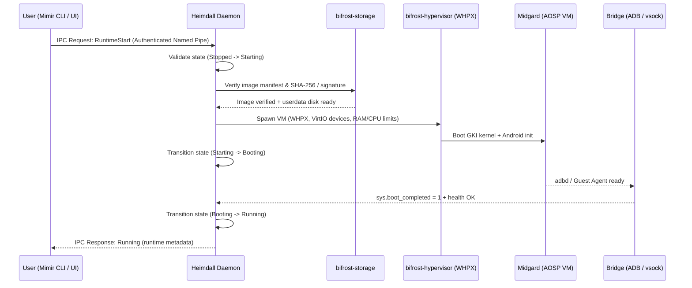

# BIFRÖST System Architecture

> **Status**: Baseline Architecture (Milestone 0)  
> **Primary Language**: Rust  
> **Target Platform**: Windows 11 x64 (Home, Pro, Enterprise)

---

## 1. Architectural Principles

1. **Modular Rust Core**: All runtime orchestration, supervision, configuration, security boundaries, and IPC live in modular Rust crates inside a Cargo workspace.
2. **Strict Separation of Concerns**:
   - The desktop UI (`bifrost-ui`) is a thin presentation client over authenticated local IPC — it **never** owns VM lifecycle or privileged runtime logic.
   - `heimdall` supervises and coordinates subsystems without becoming a monolith containing business logic.
   - `bifrost-hypervisor` abstracts the VMM backend so Midgard is never permanently locked to a single hypervisor wrapper.
3. **Windows 11 Home First-Class Support**: Core virtualization relies on the **Windows Hypervisor Platform (WHPX)** rather than Pro-only Hyper-V management APIs.
4. **Defense in Depth**: Loopback/vsock-only ADB, SID-authenticated Windows Named Pipes for local IPC, strict path canonicalization, cryptographic verification of Midgard runtime images, and minimal `unsafe` Rust.
5. **Honest Incremental Delivery**: Every vertical slice must compile, pass tests, and report unsupported capabilities explicitly without fake success paths.

---

## 2. High-Level System Architecture



---

## 3. Component Responsibilities

### 3.1 Bifrost Core (`crates/bifrost-core`) — *Planned: Milestone 1*
Central shared library imported across host binaries:
- **Runtime State Machine**: Deterministic states (`Stopped`, `Starting`, `Booting`, `Running`, `Degraded`, `Stopping`, `Failed`) with explicit valid transitions.
- **Configuration System**: Typed TOML configuration with schema versioning, validation (CPU/RAM/storage bounds, DPI/resolution ranges), and safe path resolution.
- **Domain Models**: Runtime instance descriptors, system compatibility reports, installed package metadata, diagnostic bundles.
- **Error Taxonomy**: Structured `thiserror` error types with actionable remediation hints.
- **Observability**: `tracing`-based structured logging (console + rotating file logs).

### 3.2 Mimir (`crates/mimir`) — *Planned: Milestone 1–5*
Administrative CLI binary (`bifrost.exe`):
- Local-only commands (run without Heimdall): `bifrost doctor`, `bifrost version`, `bifrost config validate`.
- Daemon-backed commands (via Heimdall IPC): `bifrost status`, `bifrost runtime start|stop|restart`, `bifrost devices`, `bifrost apps list`, `bifrost install <apk>`, `bifrost uninstall <pkg>`, `bifrost logs`.
- Any unimplemented subcommand exits with an explicit `Unsupported` error code and message.

### 3.3 Heimdall (`crates/heimdall`) — *Planned: Milestone 4*
Background runtime supervisor:
- Owns runtime lifecycle orchestration (start, graceful ACPI/ADB shutdown, forced kill timeout, crash recovery with backoff).
- Exposes authenticated local IPC via Windows Named Pipes restricted to the current user SID.
- Collects health heartbeats from Midgard and exposes runtime telemetry (CPU, RAM, disk, uptime, active apps).
- Never embeds low-level hypervisor or ADB protocol parsing directly — delegates to `bifrost-hypervisor`, `bifrost-runtime`, `bifrost-bridge`, and `valhalla`.

### 3.4 Midgard (`crates/bifrost-runtime`, `crates/bifrost-hypervisor`, `crates/bifrost-storage`, `android/midgard`) — *Planned: Milestone 3*
Real Android x86_64 execution environment:
- **Guest OS**: Clean AOSP x86_64 (Android 15/16) with GKI kernel and VirtIO drivers.
- **Virtualization Abstraction**: `HypervisorBackend` trait supporting:
  - *Milestone 3*: WHPX-accelerated QEMU backend for rapid, verifiable Android boot.
  - *Target Evolution*: Rust-native `crosvm` backend over WHPX + `virtio-gpu` (`gfxstream`).
- **Storage**: Immutable verified system/vendor/boot partitions + persistent read-write `userdata` virtual disk preserved across compatible Midgard upgrades.

### 3.5 Bridge (`crates/bifrost-bridge`) — *Planned: Milestone 4–6*
Windows ↔ Android communication fabric:
- **ADB Orchestration**: Local loopback-only ADB transport (`127.0.0.1:<ephemeral-or-configured-port>`), never bound to `0.0.0.0` by default.
- **Control & Event Channel**: Typed RPC over `virtio-vsock` (or localhost socket fallback during bring-up) carrying health metrics, notifications, clipboard sync, and app lifecycle events.
- **File Sharing**: Scoped host-to-guest directory sharing (`virtio-fs` or controlled bridge transfer) with strict canonical path checks preventing directory traversal.

### 3.6 Valhalla (`crates/valhalla`) — *Planned: Milestone 5*
Android application lifecycle manager:
- Queries actual Android `PackageManager` (`pm`) via Bridge — never fabricates app lists.
- Validates APK files (path safety, zip/APK manifest sanity, ABI compatibility check warning if `x86_64` native libs are missing) before invoking Android's native installer.
- Launches and terminates Android activities via `ActivityManager` (`am`).

### 3.7 Desktop Application (`apps/bifrost-ui`) — *Planned: Milestone 7*
Windows 11 Fluent Design desktop shell:
- Built with **Tauri 2** (Rust backend + lightweight WebView2 frontend) for Dashboard, Application Manager, Runtime Configuration, Diagnostics, and Settings.
- Communicates exclusively with `heimdall` over authenticated local IPC.
- Independent Android app windows (Milestone 6) use a dedicated **lightweight native Win32 + D3D12/Vulkan host window** rather than WebView2 to minimize frame latency and ensure native Windows Snap/DPI/input behavior.

---

## 4. Runtime Startup & IPC Sequence



---

## 5. Security Boundaries

| Boundary | Threat Mitigated | Control Mechanism |
|---|---|---|
| **Local IPC (`Mimir`/`UI` → `Heimdall`)** | Unauthorized local process hijacking runtime control | Windows Named Pipes (`\\.\pipe\bifrost-heimdall-<sid>`) created with explicit user-only DACL + strict message schema validation |
| **ADB Transport** | Remote network takeover of Android guest | Bound strictly to `127.0.0.1` by default; explicit opt-in warning if ever exposed |
| **APK & File Operations** | Path traversal, malicious install scripts, arbitrary file write | Canonical path validation, rejection of `..`/reparse-point escapes, never executing bundled shell/install scripts, delegating installs strictly to Android `pm` |
| **Runtime Image Updates** | Tampered OS images / supply-chain compromise | Mandatory SHA-256 + Ed25519 signature verification prior to boot; read-only system partitions |
| **Destructive Operations** | Accidental wipe of Android `userdata` | Explicit interactive/flag confirmation (`--confirm`) and separate persistent `userdata` disk |
| **Privilege Model** | Unnecessary elevation expanding blast radius | Entire control plane and VM run unprivileged under standard user account; elevation requested only if user explicitly opts to enable Windows `HypervisorPlatform` feature |

---

## 6. Planned Cargo Workspace Layout

Crates are created **only when their milestone begins** (no empty placeholder crates):

```text
bifrost/
├── Cargo.toml                  # Workspace manifest (Milestone 1)
├── crates/
│   ├── bifrost-core/           # Milestone 1: models, config, errors, state, logging
│   ├── mimir/                  # Milestone 1: CLI binary (`bifrost`)
│   ├── bifrost-diagnostics/    # Milestone 2: Windows compatibility & WHPX checks (or inside bifrost-core)
│   ├── bifrost-storage/        # Milestone 3: image verification & virtual disk management
│   ├── bifrost-hypervisor/     # Milestone 3: WHPX VMM abstraction (QEMU -> crosvm)
│   ├── bifrost-runtime/        # Milestone 3: Midgard lifecycle & boot orchestration
│   ├── bifrost-bridge/         # Milestone 4: ADB, vsock IPC, events, files, clipboard
│   ├── heimdall/               # Milestone 4: background supervisor daemon
│   └── valhalla/               # Milestone 5: APK & Android package management
├── apps/
│   └── bifrost-ui/             # Milestone 7: Windows 11 Fluent desktop app
├── android/
│   └── midgard/                # Milestone 3+: AOSP device config, build scripts, guest agent
└── docs/
    ├── decisions/              # Architecture Decision Records (ADRs)
    ├── research/               # Feasibility & technical research reports
    └── TECHNICAL_DECISIONS.md  # ADR index & summary
```

---

## 7. Known Architectural Limitations (Current Stage)

- **Milestone 0 Only**: No Rust workspace or executable code has been written yet.
- **ARM64 Translation**: `Unsupported`. Only pure ART (Java/Kotlin) and `x86_64` native APKs are in scope for Milestones 1–7.
- **Independent App Windows**: `Planned` for Milestone 6; Milestones 3–5 operate in console/single-display mode.
- **AOSP Image Building**: Requires a Linux x86_64 host (64 GB RAM recommended); Windows hosts consume prebuilt, cryptographically verified Midgard image bundles.
