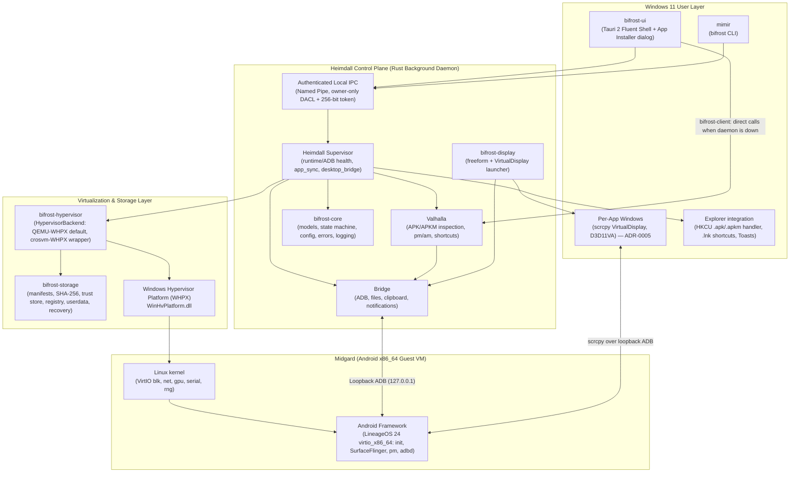
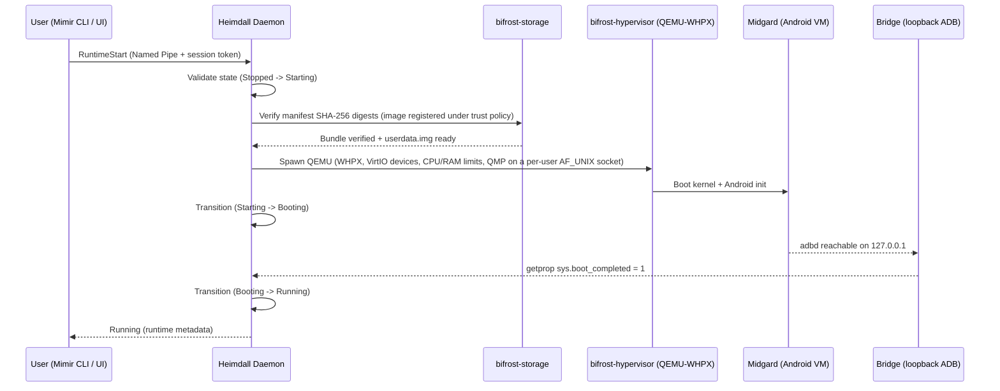

# BIFRÖST System Architecture

> **Status**: Implemented through `v0.5.0` (Milestones 0–8 + post-M8 desktop integration)
> **Primary Language**: Rust (13-crate Cargo workspace, `116` unit/IPC/fuzz tests)
> **Target Platform**: Windows 11 x64 (Home, Pro, Enterprise)

This document describes the architecture **as implemented**. Where the implementation deviates from the original Milestone 0 design, the deviation is called out and recorded in an ADR.

---

## 1. Architectural Principles

1. **Modular Rust Core**: All runtime orchestration, supervision, configuration, security boundaries, and IPC live in modular Rust crates inside a Cargo workspace.
2. **Strict Separation of Concerns**:
   - The desktop UI (`bifrost-ui`) is a presentation client; its Rust `service` module delegates to the same crates the CLI uses and never embeds VM lifecycle logic in the frontend.
   - `heimdall` supervises and coordinates subsystems without becoming a monolith containing business logic.
   - `bifrost-hypervisor` abstracts the VMM backend so Midgard is never permanently locked to a single hypervisor wrapper.
3. **Windows 11 Home First-Class Support**: Core virtualization relies on the **Windows Hypervisor Platform (WHPX)** rather than Pro-only Hyper-V management APIs.
4. **Defense in Depth**: Loopback-only ADB, owner-only DACL + session-token Windows Named Pipes, strict path validation, quoted `adb shell` arguments, trust-store-verified Midgard images, and audited minimal `unsafe` Rust.
5. **Honest Incremental Delivery**: Every vertical slice must compile, pass tests, and report unsupported capabilities explicitly without fake success paths.

---

## 2. High-Level System Architecture (as implemented)



There is **no Midgard guest agent** and **no `virtio-vsock` channel** yet: every host ↔ guest interaction goes through loopback ADB (`pm`, `am`, `dumpsys`, `cmd clipboard`, `getprop`), polled by Heimdall.

---

## 3. Component Responsibilities

| Component | Crate(s) | Status | Responsibility |
|---|---|---|---|
| Bifrost Core | `bifrost-core` | Implemented | Runtime state machine (`Stopped`, `Starting`, `Booting`, `Running`, `Degraded`, `Stopping`, `Failed`), versioned TOML config (`[runtime]`, `[display]`, `[desktop]`, `[network]`, `[logging]`, `[images]`), path guards, error taxonomy, `tracing` setup, host auto-tune. |
| Diagnostics | `bifrost-diagnostics` | Implemented | `bifrost doctor`: Windows edition, CPU virtualization, live `WHvCreatePartition`, RAM, disk, DXGI GPU, host tooling (QEMU, EDK2, `adb`, `scrcpy`, images). |
| Client facade | `bifrost-client` | Implemented | `Session` shared by Mimir and the desktop UI: loads the effective config, probes Heimdall once, routes each runtime/app operation over IPC when the daemon answers or directly otherwise (blocking calls on Tokio's blocking pool), reconciles `Booting` → `Running` over ADB, auto-boots Midgard headless before app launch/install, and starts Heimdall detached. |
| Mimir | `mimir` (`bifrost.exe`) | Implemented | Administrative CLI on top of `bifrost-client`. |
| Heimdall | `heimdall` (`heimdall.exe`) | Implemented | Tokio daemon: Named Pipe server (`\\.\pipe\bifrost-heimdall-<user>`), periodic runtime/ADB health, `app_sync` (shortcuts for apps installed inside Android), `desktop_bridge` (native WinRT Toast forwarding, clipboard auto-sync), optional HKCU login autostart. |
| Midgard | `bifrost-hypervisor`, `bifrost-runtime`, `bifrost-storage`, `android/midgard` | Implemented (QEMU-WHPX); Experimental (crosvm-WHPX) | Verified boot of `direct_kernel`, `bootable_image`, or `uefi_disks` bundles; persistent `userdata.img`; QMP shutdown; serial/VMM logs; DirectSound audio; optional headless `virtio-gpu-gl-pci`. |
| Bridge | `bifrost-bridge`, `bifrost-process`, `bifrost-network` | Implemented | Loopback ADB wrapper, scoped shared folder (`/sdcard/BifrostShare`), Win32 clipboard, notification parsing + Toasts, guest processes, loopback port forwards, IPC framing and client. |
| Valhalla | `valhalla` | Implemented | APK/APKM inspection (Zip-Slip, AXML, SHA-256, ADR-0004 ABI), `pm`/`am` install/launch/stop, Desktop & Start Menu `.lnk` + `.ico`, HKCU file association. |
| Display | `bifrost-display` | Implemented (via `scrcpy`) | Android freeform setup and per-app `VirtualDisplay` windows using `scrcpy >= 3.0 --new-display` (see ADR-0005). |
| Desktop UI | `apps/bifrost-ui` | Implemented | Tauri 2 Fluent shell (Dashboard, Apps, Runtime Config, Diagnostics, Images & Recovery, Settings) and compact App Installer dialog (`--install-apk`). |

### 3.1 External host dependencies

BIFRÖST does not bundle a VMM or ADB. It drives the following external processes:

| Tool | Used by | License note |
|---|---|---|
| `qemu-system-x86_64` (+ EDK2 firmware) | `bifrost-hypervisor` (default backend) | GPLv2, run strictly as an external child process |
| `crosvm` (Windows build) | `bifrost-hypervisor` (optional backend) | BSD-3-Clause; no official Windows binary yet |
| `adb` (Android platform-tools) | `bifrost-bridge` | Apache-2.0 |
| `scrcpy >= 3.0` | `bifrost-display` | Apache-2.0 |

---

## 4. Runtime Startup & IPC Sequence



Launching an app or double-clicking an `.apk` while Midgard is stopped triggers the same sequence in invisible `--headless` mode from the active registered image (auto-boot).

---

## 5. Security Boundaries

| Boundary | Threat Mitigated | Control Mechanism |
|---|---|---|
| **Local IPC (`Mimir`/`UI` → `Heimdall`)** | Local process hijacking runtime control | Named Pipe with owner-only SDDL DACL (`D:(A;;GA;;;OW)`), 256-bit session token compared in constant time, 64 KiB bounded JSON frames |
| **ADB transport** | Remote takeover of the Android guest | Bound to `127.0.0.1` by default; non-loopback requires `allow_non_loopback_adb = true` |
| **Host → guest shell** | Command injection through `adb shell` (which evaluates arguments with `sh`) | Arbitrary data such as clipboard text is streamed through stdin to a fixed script (`run_adb_with_stdin`); other host-controlled values are quoted with `quote_android_shell_arg` or validated against strict character sets |
| **APK & file operations** | Path traversal, Zip Slip, malicious install scripts | Path validation, Zip-Slip rejection for outer and inner archives, installs delegated strictly to Android `pm` |
| **Windows integration** | Script injection via app labels or notification text | No scripts at runtime: Toasts use WinRT under the `BIFROST.Bifrost` AppUserModelID, registry writes use `winreg`, `.lnk` files are written natively (`mslnk`), file pickers use `IFileOpenDialog` (`rfd`); Toast XML is XML-escaped |
| **VM control (QMP)** | Local processes or other users powering off or controlling the VM | QMP is exposed only on an AF_UNIX socket file with a random 128-bit name (`unix:<data_dir>\run\qmp-<hex>.sock`, `%TEMP%\bifrost-run` fallback), never on TCP; Windows checks the file ACL on `connect` and the directory inherits the per-user `%LOCALAPPDATA%` ACL. `server=on,wait=off` keeps QEMU from blocking boot, and QEMU deletes the socket on exit |
| **Runtime images** | Tampered or untrusted OS images | SHA-256 digest verification of every artifact before boot; Ed25519 signature must verify against `[images] trusted_keys`; unsigned bundles only with explicit `--allow-unsigned` (ADR-0006) |
| **Destructive operations** | Accidental wipe of Android `userdata` | Separate persistent `userdata.img`; `--confirm` required for restore/wipe; uninstaller purges only with `-PurgeUserData -ConfirmPurge` |
| **Privilege model** | Unnecessary elevation | Control plane, VM, installer and file associations run unprivileged (HKCU, `%LOCALAPPDATA%`); elevation only to enable the `HypervisorPlatform` feature |

---

## 6. Cargo Workspace Layout

```text
bifrost/
├── Cargo.toml                  # Workspace manifest (13 members, unsafe_code = "deny")
├── crates/
│   ├── bifrost-core/           # Models, config, errors, state machine, paths, logging
│   ├── bifrost-diagnostics/    # Windows 11 / WHPX / host tooling checks (bifrost doctor)
│   ├── bifrost-storage/        # Manifests, SHA-256, Ed25519 trust store, registry, userdata, recovery
│   ├── bifrost-hypervisor/     # HypervisorBackend trait, QEMU-WHPX, crosvm-WHPX, QMP
│   ├── bifrost-runtime/        # Midgard lifecycle, runtime-state.json, logs
│   ├── bifrost-bridge/         # ADB, files, clipboard, notifications, IPC framing + client
│   ├── bifrost-client/         # Session facade shared by mimir and bifrost-ui
│   ├── bifrost-display/        # Freeform + per-app VirtualDisplay windows (scrcpy)
│   ├── bifrost-process/        # Guest process listing
│   ├── bifrost-network/        # Loopback-only TCP port forwards
│   ├── valhalla/               # APK/APKM management, shortcuts, HKCU file association
│   ├── heimdall/               # Supervisor daemon (heimdall.exe)
│   └── mimir/                  # CLI (bifrost.exe)
├── apps/bifrost-ui/            # Tauri 2 desktop app (13th workspace member: src-tauri)
├── android/midgard/            # Bundle manifest format & template
├── installer/windows/          # Release packager, unprivileged installer/uninstaller
└── docs/                       # ADRs and research reports
```

---

## 7. Known Architectural Limitations (Current Stage)

- **No guest agent / vsock channel**: Health, notifications and clipboard rely on polling loopback ADB (`dumpsys`, `cmd clipboard`). Android → Windows clipboard sync is not implemented; sync is Windows → Android only.
- **Per-app windows depend on `scrcpy`**: Windows are scrcpy-rendered video streams of Android `VirtualDisplay`s, not the native Win32 + D3D12 host originally planned in ADR-0003 (see ADR-0005).
- **crosvm-WHPX is a wrapper only**: `CrosvmWhpxBackend` builds the command line but has not been run live; no official Windows `crosvm` + `gfxstream` binary exists yet.
- **3D acceleration is experimental**: Default graphics are `virtio-gpu-pci` (2D DRM/KMS, software rendering in the guest); `virtio-gpu-gl-pci` + `egl-headless` is opt-in.
- **No first-party image pipeline**: The verified image is a prebuilt LineageOS 24.0 `virtio_x86_64` bundle; reproducible AOSP builds in Linux CI (ADR-0001) are still planned.
- **ARM64 translation**: `Unsupported` (ADR-0004).
- **Test coverage**: Unit and IPC tests only; there are no automated end-to-end tests against a live VM.
