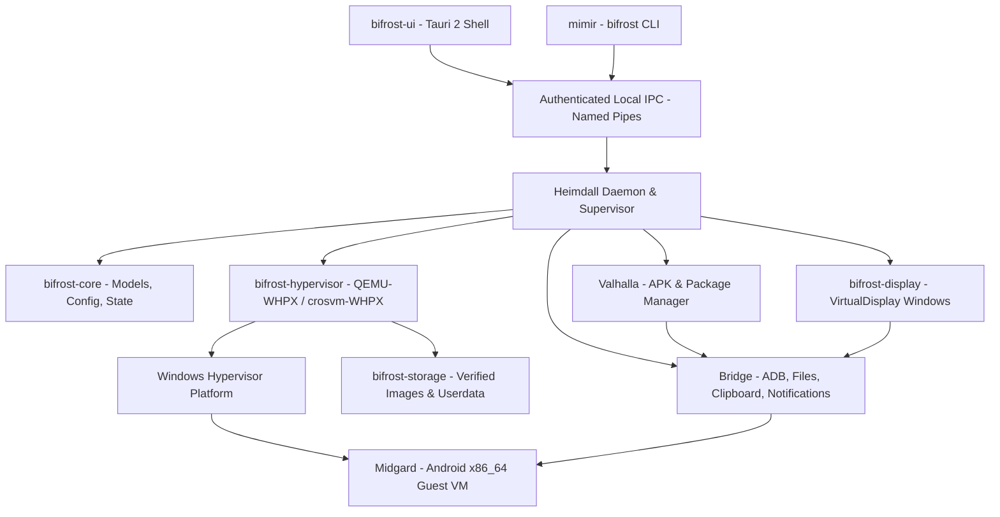

# 🌈 BIFRÖST

[](https://www.rust-lang.org/)
[](https://v2.tauri.app/)
[-0078D4?style=flat-square&logo=windows11)](https://learn.microsoft.com/en-us/virtualization/api/)
[](https://source.android.com/)
[](https://learn.microsoft.com/en-us/virtualization/api/hypervisor-platform/hypervisor-platform)
[](LICENSE)
[](https://github.com/kiramman-mp3/bifrost/actions/workflows/ci.yml)

**BIFRÖST** is an open-source, Rust-powered Android subsystem for Windows 11 x64 designed to run real Android applications with deep native desktop integration — *"A Bridge Between Worlds."*

Inspired by Bifröst from Norse mythology and engineered as a modern, auditable, community-maintained successor to Microsoft's discontinued Windows Subsystem for Android (WSA), BIFRÖST v0.4.0 delivers **Milestones 0 through 8 plus full WSA-grade desktop integration** across a modular Rust workspace (`13` crates, `116` passing tests): native Windows 11 / WHPX + host tooling diagnostics, invisible headless auto-boot on app launch or APK/APKM install, QEMU-WHPX with dedicated `iothread` VirtIO block I/O + DirectSound audio + `virtio-gpu-pci` / experimental headless `virtio-gpu-gl-pci` (`blob=on,hostmem=256M`) + `crosvm-WHPX` backend, Heimdall authenticated Named Pipe daemon with optional silent Windows login autostart + automatic in-Android shortcut sync + real-time Windows 11 Toast notifications + auto clipboard sync, unprivileged `HKCU` `.apk` / `.apkm` Explorer double-click & context menu handler launching a native Fluent App Installer dialog (with Install/Update detection & live progress bar), Valhalla single-pass APK/APKM split-bundle & ABI manager, WSA-style dedicated dynamically resizable per-app windows (`--flex-display`, 60 FPS), Windows 11 Fluent Design 2 Tauri 2 desktop app (with host auto-tune, cached instant refreshes, native file/folder pickers, `.apk`/`.apkm` drag-and-drop, and Midgard Images & Recovery management), and unprivileged Windows installer.

> [!TIP]
> **Quick start (`v0.4.0`)**: Download the latest Windows x64 release bundle or run directly from source:
> ```powershell
> $env:CARGO_TARGET_DIR = "$env:TEMP\bifrost-target" # required with MinGW ld if repo path contains non-ASCII characters
> cargo test --workspace
> cargo run -p mimir -- doctor
> cargo run -p mimir -- version
> cargo run -p bifrost-ui
> ```

---

## 📖 Description

### What problem does it solve?
Following the discontinuation of Microsoft's Windows Subsystem for Android (WSA), Windows 11 users and developers lack an open-source, actively maintained, auditable way to run Android applications natively on Windows 11 — especially on **Windows 11 Home**, where the full Hyper-V management role is unavailable. Traditional emulators bundle monolithic single-window interfaces, opaque telemetry, or proprietary components.

### What does it do?
BIFRÖST follows a modular, privilege-separated runtime lifecycle:
1. **System verification (`mimir` + `bifrost-diagnostics`)**: `bifrost doctor` inspects Windows 11 edition, CPU virtualization, `WinHvPlatform.dll` (`WHvGetCapability` + live `WHvCreatePartition`), memory, disk space, and DXGI GPU capabilities.
2. **Runtime verification (`bifrost-storage`)**: Verifies Midgard Android `x86_64` image manifests via streaming SHA-256 digests and optional Ed25519 signatures, tracks compatible versions in a local registry, and manages a persistent `userdata` virtual disk.
3. **Supervised VM execution (`heimdall` + `bifrost-hypervisor` + `bifrost-runtime`)**: Starts an unprivileged WHPX-accelerated Android `x86_64` VM (`direct_kernel`, `bootable_image`, or `uefi_disks` with EDK2 `pflash` and auto-detected `qcow2`/`raw` NVRAM), exposes loopback-only QMP shutdown and serial logs, and supervises health over an owner-DACL Windows Named Pipe.
4. **Windows ↔ Android bridge (`bifrost-bridge`, `bifrost-process`, `bifrost-network`)**: Connects loopback-only ADB, scoped host ↔ Android shared folders (`/sdcard/BifrostShare`), Win32 Unicode clipboard sync, Android notification parsing + Toast XML generation, guest process inspection, and loopback TCP port forwarding.
5. **Native package & window integration (`valhalla`, `bifrost-display`, `bifrost-ui`)**: Inspects APKs (ZIP structure, Zip-Slip rejection, SHA-256, ADR-0004 `x86_64` ABI check), installs/launches apps via Android `pm`/`am`, projects individual apps in independent Windows 11 `VirtualDisplay` windows (`bifrost apps launch --window`), and exposes all controls in a Windows 11 Fluent Design 2 Tauri 2 desktop app.

### Who is it for?
- **Windows 11 users** (Home, Pro, and Enterprise) who want clean, ad-free, open-source Android app execution without proprietary bloat.
- **Android and Rust systems developers** who need an inspectable, ADB-accessible, VirtIO-based Android subsystem on Windows.

---

## 📸 Screenshots

The `bifrost-ui` Windows 11 Fluent Design 2 desktop application (`apps/bifrost-ui`) is implemented with Dark/Light themes and 6 views (Dashboard, Application Manager, Runtime Configuration, Diagnostics, Images & Recovery, and Settings), native Windows file/folder pickers, and drag-and-drop `.apk` inspection. Local capture images will be stored under `docs/screenshots/` once curated without host-specific data.

---

## ✨ Features

- **Modular Rust control plane (`bifrost-core`, `heimdall`, `mimir`)**: State machine, TOML config validation, authenticated background daemon, and full administrative CLI implemented in Rust with workspace-wide `unsafe_code = "deny"` (and `#![forbid(unsafe_code)]` across 10 crates).
- **Windows 11 Home & Pro compatibility (`bifrost-diagnostics`, `bifrost-hypervisor`)**: Targets Windows Hypervisor Platform (`WHPX`) behind a VMM-agnostic `HypervisorBackend` trait (`QemuWhpxBackend` verified live on Windows 11 Home 25H2 + `CrosvmWhpxBackend` target backend), avoiding Pro-only Hyper-V dependencies.
- **Clean-room open-source Android `x86_64` foundation (`bifrost-storage`, `bifrost-runtime`)**: Verified live with pure open-source LineageOS 24.0 (`virtio_x86_64`) and aligned with AOSP Cuttlefish / VirtIO, with zero bundled Google Play Services or proprietary ARM translators.
- **Independent per-app Windows 11 windows (`bifrost-display`)**: Configures Android freeform multi-display flags and launches apps in isolated `VirtualDisplay` Windows 11 desktop windows via `bifrost apps launch <pkg> --window`.
- **Deep Windows ↔ Android integration (`bifrost-bridge`, `valhalla`, `bifrost-process`, `bifrost-network`)**: Real APK inspection and `pm`/`am`/`dumpsys` management, scoped shared folders, native Win32 clipboard sync, notification parsing, guest process inspection, and loopback port forwards.
- **Windows 11 Fluent Design 2 desktop shell (`apps/bifrost-ui`)**: Tauri 2 application backed by a pure-Rust service layer (no critical runtime logic in the frontend) with strict CSP and offline-first assets.
- **Security-by-default boundaries and safe recovery**: Loopback-only ADB, quoted `adb shell` arguments, owner-only SDDL Named Pipe DACL (`D:(A;;GA;;;OW)`) + 256-bit session tokens, path-traversal guards, SHA-256 image verification with an Ed25519 publisher trust store (`[images] trusted_keys`, ADR-0006), and SHA-256-verified userdata backup/restore.

---

## 🛠️ Technologies Used

- **Frontend / Desktop UI**: Tauri 2 (`apps/bifrost-ui`), WebView2, offline-first HTML/CSS/ES with Windows 11 Fluent Design 2 styling (Dark & Light themes).
- **Backend & Control Plane**: Rust (`edition = "2021"`, `rust-version = "1.89"`), Cargo workspace (`13` crates), `tokio`, `serde`, `serde_json`, `toml`, `tracing`, `thiserror`, `clap`, `sha2`, `ed25519-dalek`, `zip`, `windows` crate.
- **Virtualization & Android Guest**: Windows Hypervisor Platform (`WHPX`), QEMU `11.1.0` (`q35,accel=whpx`, EDK2 UEFI `pflash`, VirtIO storage/net/serial/RNG, QMP) and `crosvm` (`whpx` + `gfxstream`), Android `x86_64` VirtIO / AOSP / LineageOS, `adb`, `scrcpy >= 3.0`.
- **Testing & Quality Gates**: `cargo test --workspace` (`116` passing tests: `94` unit/IPC + `22` property-based fuzz; `4` opt-in tests ignored by default), `cargo clippy --workspace --all-targets --locked -- -D warnings`, `cargo fmt --all -- --check`, `cargo deny check` (`deny.toml`).
- **Distribution & CI**: PowerShell release packager (`build-release-bundle.ps1`), unprivileged SHA-256-verified Windows user-space installer/uninstaller (`install-bifrost.ps1`, `uninstall-bifrost.ps1`), and GitHub Actions Windows CI (`.github/workflows/ci.yml`).

---

## 🏗️ Architecture

BIFRÖST separates presentation (`bifrost-ui`, `mimir`), supervision (`heimdall`), Windows ↔ Android communication (`bifrost-bridge`, `valhalla`, `bifrost-display`), and virtualization (`bifrost-hypervisor`, `bifrost-runtime`, `bifrost-storage`) across explicit security boundaries so no UI layer owns critical runtime logic.



For detailed component contracts, runtime boot sequences, and security boundaries, see [ARCHITECTURE.md](ARCHITECTURE.md).

---

## 📁 Project Structure

```bash
BIFRÖST/
├── .github/workflows/ci.yml                       # Automated Windows x64 CI (fmt, clippy, test, release build)
├── .github/workflows/release.yml                  # Tag-driven release: optional Authenticode signing, provenance, GitHub Release
├── .gitignore                                     # Rust, /dist/, Windows, disk images, logs, and secrets exclusions
├── Cargo.toml                                     # Cargo workspace manifest (13 crates, unsafe_code = "deny")
├── Cargo.lock                                     # Reproducible dependency lockfile
├── LICENSE                                        # Apache License 2.0
├── ARCHITECTURE.md                                # System architecture, diagrams, and security boundaries
├── CHANGELOG.md                                   # Versioned project changelog (Keep a Changelog)
├── CLAUDE.md                                      # Engineering context, Git workflow, and documentation rules
├── CONTRIBUTING.md                                # Contribution guidelines, Git Flow, and Rust standards
├── README.md                                      # Project overview and documentation entry point
├── ROADMAP.md                                     # Milestones M0–M8, v0.1.0–v0.4.0 releases, and next steps
├── SECURITY.md                                    # Mandatory security invariants and vulnerability disclosure policy
├── master_prompt.md                               # Master engineering specification
├── android/
│   └── midgard/                                   # Midgard bundle documentation & manifest template
│       ├── README.md
│       └── manifest.example.json
├── apps/
│   └── bifrost-ui/                                # Windows 11 Fluent Design 2 desktop application (Tauri 2)
│       ├── ui/                                    # Offline-first HTML/CSS/ES frontend (Dark & Light themes, 6 sections, drag & drop)
│       │   ├── index.html
│       │   ├── styles.css
│       │   └── app.js
│       └── src-tauri/                             # Pure-Rust backend (`#![forbid(unsafe_code)]`)
│           ├── Cargo.toml
│           ├── tauri.conf.json
│           ├── build.rs                           # ASCII OUT_DIR icon staging for GNU windres
│           ├── capabilities/default.json          # Least-privilege Tauri 2 capability
│           ├── icons/                             # App icon assets (icon.png, icon.ico)
│           └── src/
│               ├── main.rs                        # Thin `#[tauri::command]` bindings
│               └── service.rs                     # Testable Rust service integrating all crates
├── installer/
│   ├── README.md                                  # Distribution, installation, upgrade & recovery runbook
│   └── windows/
│       ├── build-release-bundle.ps1               # Release packager: optional Authenticode signing, SHA-256 manifest, versioned zip
│       ├── install-bifrost.ps1                    # Unprivileged user-space Windows installer (SHA-256 verified)
│       └── uninstall-bifrost.ps1                  # Clean uninstaller preserving Android userdata by default
├── crates/
│   ├── bifrost-core/                              # Shared domain models, state machine, TOML config, path security, logging
│   │   ├── Cargo.toml
│   │   ├── tests/fuzz_untrusted_inputs.rs         # proptest fuzzing of untrusted inputs (weekly deep run in CI)
│   │   └── src/
│   │       ├── lib.rs                             # #![forbid(unsafe_code)]
│   │       ├── capabilities.rs                    # FeatureStatus and VersionInfo models
│   │       ├── config.rs                          # Versioned TOML config & security/bounds validation
│   │       ├── error.rs                           # Structured BifrostError taxonomy
│   │       ├── logging.rs                         # Tracing subscriber setup
│   │       ├── paths.rs                           # Directory traversal guards & per-user path layout
│   │       └── state.rs                           # Deterministic RuntimeStateMachine
│   ├── bifrost-diagnostics/                       # Native Windows 11 & WHPX compatibility engine (`bifrost doctor`)
│   │   ├── Cargo.toml
│   │   └── src/
│   │       ├── lib.rs                             # Public diagnostics entrypoint
│   │       ├── model.rs                           # Serializable snapshot and doctor report models
│   │       ├── evaluator.rs                       # Pure compatibility rules & unit tests
│   │       ├── format.rs                          # Human-readable terminal report renderer
│   │       └── probe_windows.rs                   # Audited Win32, Registry, CPUID, WHPX, and DXGI probes
│   ├── bifrost-storage/                           # Signed image manifests, version registry, userdata & recovery
│   │   ├── Cargo.toml
│   │   ├── tests/fuzz_untrusted_inputs.rs         # proptest fuzzing of untrusted inputs (weekly deep run in CI)
│   │   └── src/
│   │       ├── lib.rs                             # #![forbid(unsafe_code)]
│   │       ├── manifest.rs                        # Versioned bundle schema (direct_kernel, bootable_image, uefi_disks)
│   │       ├── verify.rs                          # Streaming SHA-256 verification & root containment
│   │       ├── signature.rs                       # Pure-Rust Ed25519 manifest signature verification
│   │       ├── trust.rs                           # Trust-store signature policy & explicit unsigned opt-in (ADR-0006)
│   │       ├── registry.rs                        # Local Midgard image catalog & upgrade/downgrade safety
│   │       ├── recovery.rs                        # SHA-256-verified userdata backup & guarded restore
│   │       └── disk.rs                            # Persistent userdata.img creation & guarded wipe
│   ├── bifrost-hypervisor/                        # VMM-agnostic WHPX abstraction (QEMU-WHPX + crosvm-WHPX)
│   │   ├── Cargo.toml
│   │   └── src/
│   │       ├── lib.rs                             # #![forbid(unsafe_code)]
│   │       ├── backend.rs                         # HypervisorBackend trait, VmSpec, VmLaunchInfo
│   │       ├── qmp.rs                             # QMP client over a per-user AF_UNIX socket (timeouts, legacy TCP)
│   │       ├── qemu_whpx.rs                       # QEMU-WHPX arg builder (direct_kernel, ISO, UEFI pflash), launch & shutdown
│   │       └── crosvm_whpx.rs                     # Target-evolution crosvm WHPX + gfxstream backend
│   ├── bifrost-runtime/                           # Midgard lifecycle orchestration, state persistence & log reader
│   │   ├── Cargo.toml
│   │   └── src/
│   │       ├── lib.rs                             # #![forbid(unsafe_code)]
│   │       ├── state_store.rs                     # Atomic runtime-state.json persistence
│   │       ├── lifecycle_lock.rs                  # Cross-process lock serializing VM start/stop/restart
│   │       └── manager.rs                         # MidgardRuntime start/stop/restart/status/logs
│   ├── bifrost-bridge/                            # Loopback ADB, shared dirs, Win32 clipboard, notifications & IPC
│   │   ├── Cargo.toml
│   │   ├── tests/fuzz_untrusted_inputs.rs         # proptest fuzzing of untrusted inputs (weekly deep run in CI)
│   │   └── src/
│   │       ├── lib.rs
│   │       ├── adb.rs                             # Safe ADB wrapper, device parser & guest health probes
│   │       ├── files.rs                           # Scoped host <-> Android shared directory bridge
│   │       ├── clipboard.rs                       # Audited Win32 CF_UNICODETEXT clipboard & Android sync
│   │       ├── notifications.rs                   # Android notification parser & XML-escaped Toast XML
│   │       ├── toast.rs                           # Native WinRT Toasts under the BIFROST.Bifrost AppUserModelID
│   │       ├── ipc.rs                             # Bounded JSON frames, 256-bit auth tokens & IPC schemas
│   │       └── client.rs                          # Async Named Pipe HeimdallClient
│   ├── bifrost-display/                           # Per-app Android VirtualDisplay & independent Windows 11 window launcher
│   │   ├── Cargo.toml
│   │   └── src/lib.rs                             # #![forbid(unsafe_code)]
│   ├── bifrost-process/                           # Android guest process discovery (`ps -A` sorted by RSS)
│   │   ├── Cargo.toml
│   │   ├── tests/fuzz_untrusted_inputs.rs         # proptest fuzzing of untrusted inputs (weekly deep run in CI)
│   │   └── src/lib.rs                             # #![forbid(unsafe_code)]
│   ├── bifrost-network/                           # Unprivileged loopback-only TCP port forwarding
│   │   ├── Cargo.toml
│   │   ├── tests/fuzz_untrusted_inputs.rs         # proptest fuzzing of untrusted inputs (weekly deep run in CI)
│   │   └── src/lib.rs                             # #![forbid(unsafe_code)]
│   ├── valhalla/                                  # Real Android application & APK management (`pm`, `am`, `dumpsys`, Windows shortcuts, `.apk` handler)
│   │   ├── Cargo.toml
│   │   ├── tests/fuzz_untrusted_inputs.rs         # proptest fuzzing of untrusted inputs (weekly deep run in CI)
│   │   └── src/
│   │       ├── lib.rs                             # #![forbid(unsafe_code)]
│   │       ├── apk.rs                             # Pure-Rust APK ZIP, AXML package, PNG->ICO icon, SHA-256 & ADR-0004 ABI inspection
│   │       ├── file_assoc.rs                      # Unprivileged HKCU `.apk` Explorer context menu & default double-click registration
│   │       ├── package.rs                         # Strict package ID validation & pm/dumpsys parsers
│   │       ├── shortcuts.rs                       # Automatic Windows Desktop & Start Menu `.lnk` + `.ico` shortcut manager
│   │       └── manager.rs                         # ValhallaManager (list, info, install+shortcuts, uninstall+cleanup, launch, stop)
│   ├── heimdall/                                  # Background supervisor daemon (`heimdall` binary)
│   │   ├── Cargo.toml
│   │   └── src/
│   │       ├── main.rs                            # Tokio daemon CLI (`heimdall run`)
│   │       ├── app_sync.rs                        # Auto-sync Desktop & Start Menu shortcuts for apps installed/removed inside Android
│   │       ├── desktop_bridge.rs                  # Real-time Windows 11 Toast notification forwarder & hash-guarded clipboard sync
│   │       ├── pipe_security.rs                   # Audited Windows SDDL owner-only Named Pipe DACL (`D:(A;;GA;;;OW)`)
│   │       ├── supervisor.rs                      # Periodic runtime, ADB, app sync & desktop bridge monitoring
│   │       └── server.rs                          # Authenticated Named Pipe server & live IPC tests
│   └── mimir/                                     # Administrative CLI (`bifrost` binary)
│       ├── Cargo.toml
│       ├── tests/e2e_live_vm.rs                   # Opt-in (`--ignored`) end-to-end test against a real Midgard VM
│       └── src/
│           ├── main.rs                            # #![forbid(unsafe_code)], Tokio entrypoint & exit codes
│           ├── cli.rs                             # Clap CLI command and flag definitions
│           └── commands.rs                        # Full administrative CLI command handlers
└── docs/
    ├── TECHNICAL_DECISIONS.md                     # Architecture Decision Record (ADR) index
    ├── decisions/
    │   ├── ADR-0001-aosp-x86-64-foundation.md     # AOSP x86_64 VirtIO / Cuttlefish alignment
    │   ├── ADR-0002-whpx-vmm-abstraction.md       # WHPX-first VMM abstraction (QEMU -> crosvm)
    │   ├── ADR-0003-graphics-and-windowing-strategy.md # virtio-gpu + gfxstream & phased windowing
    │   ├── ADR-0004-arm64-compatibility-policy.md # Clean-room x86_64 policy & proprietary exclusions
    │   ├── ADR-0005-scrcpy-virtualdisplay-windowing.md # Interim per-app windows via scrcpy VirtualDisplay
    │   └── ADR-0006-image-trust-store.md          # Local Ed25519 trust store for Midgard images
    └── research/
        ├── feasibility-report.md                  # Technical feasibility & host baseline report
        └── gpu-3d-windows-evaluation.md           # Empirical Windows 11 GPU 3D evaluation (ANGLE/virgl & crosvm-whpx)
```

---

## 💻 System Requirements

### Target User Host (Windows 11)
- **OS**: Windows 11 x64 (Home, Pro, or Enterprise).
- **CPU**: 64-bit `x86_64` processor with hardware virtualization (`Intel VT-x` or `AMD-V`) and SLAT enabled in firmware.
- **Windows Feature**: **Virtual Machine Platform** (`VirtualMachinePlatform`) and/or **Windows Hypervisor Platform** (`HypervisorPlatform`) enabled so `WHvCreatePartition` succeeds.
- **RAM**: 16 GB minimum recommended (4–8 GB allocated to Midgard).
- **Storage**: 32+ GB free disk space for Android image bundles and persistent `userdata`.
- **GPU**: DirectX 12 / Vulkan-capable GPU (Intel Arc, AMD Radeon, or NVIDIA GeForce) for `virtio-gpu` / `gfxstream`.
- **Runtime Dependencies**: `qemu-system-x86_64` (`winget install SoftwareFreedomConservancy.QEMU`), Android `adb` platform-tools, and `scrcpy >= 3.0` (optional, for `--window` per-app VirtualDisplay windows).

### Development Host
- `git` and `rustup` with Rust `1.89+` (`rustfmt`, `clippy`).
- Linker toolchain: **WinLibs MinGW-w64 UCRT** (`stable-x86_64-pc-windows-gnu`, portable user-space install) or **Visual Studio 2022 C++ Build Tools** (`stable-x86_64-pc-windows-msvc`).
- *(Optional — building custom AOSP images)* Dedicated Linux `x86_64` build host with 64 GB RAM and 300–400 GB free NVMe SSD.

---

## ⚙️ Installation and Setup

1. **Clone the repository**:
   ```bash
   git clone https://github.com/kiramman-mp3/bifrost.git
   cd bifrost
   ```
2. **Install Rust and a Windows C/linker toolchain**:
   ```powershell
   winget install Rustlang.Rustup
   # Option A (no admin required — GNU UCRT toolchain):
   winget install BrechtSanders.WinLibs.POSIX.UCRT
   rustup default stable-x86_64-pc-windows-gnu
   # Option B (elevated PowerShell — MSVC toolchain):
   # winget install Microsoft.VisualStudio.2022.BuildTools
   ```
3. **Install host VM & Bridge tools**:
   ```powershell
   winget install --id SoftwareFreedomConservancy.QEMU -e --source winget
   winget install --id Genymobile.scrcpy -e --source winget
   ```
4. **Enable Windows Hypervisor Platform (if `bifrost doctor` reports WHPX inactive, elevated PowerShell)**:
   ```powershell
   DISM /Online /Enable-Feature /FeatureName:HypervisorPlatform /All
   ```
5. **Build and install BIFRÖST into your user profile (no Administrator required)**:
   ```powershell
   .\installer\windows\build-release-bundle.ps1 -OutputDir .\dist\bifrost-win64
   .\installer\windows\install-bifrost.ps1 -BundleDir .\dist\bifrost-win64
   ```
6. **Environment variables & secrets**: Optional overrides include `BIFROST_QEMU_BIN`, `BIFROST_CROSVM_BIN`, `BIFROST_ADB_BIN`, `BIFROST_SCRCPY_BIN`, and `CARGO_TARGET_DIR`. Never commit `.env` files, signing keys (`*.key`, `*.pem`, `*.pfx`), runtime images (`*.img`, `*.qcow2`), or APKs to the repository (enforced in `.gitignore`).

---

## 🚀 Usage and Execution

### Installed Release Mode (Windows 11)
After running `install-bifrost.ps1`, open a new PowerShell window (or launch **BIFRÖST** from the Windows 11 Start Menu):

```powershell
bifrost doctor
bifrost config init
heimdall run                                        # run in a background terminal
bifrost runtime start --image "<path-to-manifest.json>"
bifrost logs --tail 60
bifrost devices
bifrost apps list
bifrost apps launch com.android.settings --window   # independent Windows 11 window
bifrost runtime stop
bifrost-ui                                          # launch Fluent Design 2 desktop app
```

### Local Development Mode
When building with MinGW (`stable-x86_64-pc-windows-gnu`) inside a folder containing non-ASCII characters (`BIFRÖST`), point `CARGO_TARGET_DIR` to an ASCII path:

```powershell
$env:CARGO_TARGET_DIR = "$env:TEMP\bifrost-target"
cargo fmt --all -- --check
cargo clippy --workspace --all-targets --locked -- -D warnings
cargo test --workspace --locked
cargo build --workspace --locked
cargo deny check   # requires `cargo install cargo-deny --locked`
```

### CLI & Verification Commands

| Command | Description | Status |
|---|---|---|
| `cargo fmt --all -- --check` | Verify Rust code formatting across workspace | **Implemented** |
| `cargo clippy --workspace --all-targets --locked -- -D warnings` | Run strict Clippy static analysis against the committed `Cargo.lock` | **Implemented** |
| `cargo deny check` | Audit dependencies: RustSec advisories, Apache-2.0-compatible licenses and registry sources (`deny.toml`) | **Implemented** |
| `cargo test --workspace` | Execute unit, IPC & property-based fuzz tests (`116` tests across 13 workspace crates) | **Implemented** |
| `cargo run -p bifrost-ui` | Launch BIFRÖST Windows 11 Fluent Design desktop application | **Implemented** |
| `heimdall run` | Start background Heimdall supervisor on owner-DACL Windows Named Pipe | **Implemented** |
| `bifrost version [--json]` | Display BIFRÖST version, host target, and capability maturity | **Implemented** |
| `bifrost status [--json]` | Display reconciled Midgard runtime state and live Heimdall IPC status | **Implemented** |
| `bifrost daemon start \| status \| stop \| autostart` | Start detached Heimdall daemon, query health, stop over IPC, or toggle silent HKCU login autostart | **Implemented** |
| `bifrost config init \| show \| validate \| autotune` | Initialize, inspect, validate, or host-autotune CPU/RAM in `bifrost.toml` | **Implemented** |
| `bifrost doctor [--strict] [--json]` | Inspect Windows 11 edition, CPU, virtualization, WHPX, RAM, storage, GPU, and host runtime tooling | **Implemented** |
| `bifrost runtime start \| stop \| restart \| verify` | Verify image SHA-256 digests and manage Midgard WHPX VM lifecycle | **Implemented** |
| `bifrost logs [--tail N]` | Inspect Midgard serial console and VMM stderr logs | **Implemented** |
| `bifrost devices [--json]` | List connected Android devices via Heimdall Bridge / loopback ADB | **Implemented** |
| `bifrost apps list \| info \| launch [--window] \| stop \| shortcut` | Discover, inspect, launch (WSA-style flex window), stop, and manage Desktop/Start Menu shortcuts | **Implemented** |
| `bifrost install <app.apk\|.apkm> [--inspect-only]` | Inspect ZIP/AXML/SHA-256/`x86_64` ABI, install `.apk` or `.apkm` split bundle via Android `pm`, and create Desktop + Start Menu icons | **Implemented** |
| `bifrost uninstall <pkg> [--keep-data]` | Uninstall an Android package via Android `pm` | **Implemented** |
| `bifrost share list \| push \| pull` | Manage scoped Windows ↔ Android shared files (`/sdcard/BifrostShare`) | **Implemented** |
| `bifrost clipboard get \| sync-to-android` | Read native Win32 Unicode clipboard and sync text to Android | **Implemented** |
| `bifrost notifications list` | Inspect active Android notifications via `dumpsys` | **Implemented** |
| `bifrost processes list [--filter]` | List running Android guest processes sorted by RSS | **Implemented** |
| `bifrost network forwards \| forward \| unforward` | Manage unprivileged loopback TCP port forwards | **Implemented** |
| `bifrost images list \| register [--signature] [--allow-unsigned] \| use` | Manage SHA-256-verified Midgard versions signed by `[images] trusted_keys` (or explicitly unsigned) & upgrade compatibility | **Implemented** |
| `bifrost recovery backup \| restore \| wipe-userdata \| export-diagnostics` | Verified userdata backup/restore, guarded wipe & sanitized diagnostic bundle | **Implemented** |
| `bifrost desktop register-apk-handler \| unregister-apk-handler` | Register or remove unprivileged Windows 11 `.apk` / `.apkm` context menu & default handler (`HKCU`) | **Implemented** |

---

## 📦 Deployment and Distribution

Distribution tooling lives under [installer/](installer/README.md), [.github/workflows/ci.yml](.github/workflows/ci.yml) and [.github/workflows/release.yml](.github/workflows/release.yml):
- Pushing a `vX.Y.Z` tag runs the release workflow: quality gates, an MSVC release build, optional Authenticode signing (`WINDOWS_SIGNING_PFX_*` secrets), a Sigstore build-provenance attestation, and a GitHub Release with notes from the CHANGELOG.
- `installer/windows/build-release-bundle.ps1` builds `bifrost.exe`, `heimdall.exe`, and `bifrost-ui.exe` in release mode, bundles the installer scripts and `LICENSE`, optionally signs them, and emits a BOM-free `release-checksums.sha256` manifest plus `bifrost-vX.Y.Z-win64.zip` (`-Zip`).
- `installer/windows/install-bifrost.ps1` verifies every SHA-256 digest before installing unprivileged into `%LOCALAPPDATA%\Programs\BIFRÖST`, updating user `PATH`, and creating a Start Menu shortcut while preserving existing Android `userdata`.
- `installer/windows/uninstall-bifrost.ps1` removes binaries and shortcuts cleanly while keeping `%LOCALAPPDATA%\bifrost` intact unless `-PurgeUserData -ConfirmPurge` is explicitly specified.
- Midgard runtime bundles are SHA-256 verified; Ed25519 signatures are accepted only from publisher keys in `bifrost.toml` `[images] trusted_keys`, and unsigned bundles need `--allow-unsigned` (ADR-0006); no proprietary Google Play Services, GApps, `libhoudini`, or `libndk_translation` binaries are ever distributed.

---

## 🔬 Technical Architecture & Decisions

### Architecture Decision Records

| ADR | Decision | Status |
|---|---|---|
| [ADR-0001](docs/decisions/ADR-0001-aosp-x86-64-foundation.md) | Use AOSP `x86_64` (Android 15/16+, VirtIO / Cuttlefish-aligned) built in Linux CI | Accepted |
| [ADR-0002](docs/decisions/ADR-0002-whpx-vmm-abstraction.md) | Target WHPX behind a Rust `HypervisorBackend` trait (`QEMU-WHPX` → `crosvm`) | Accepted |
| [ADR-0003](docs/decisions/ADR-0003-graphics-and-windowing-strategy.md) | Use `virtio-gpu` + `gfxstream` and phased windowing (single display → per-app `VirtualDisplay`) | Accepted |
| [ADR-0004](docs/decisions/ADR-0004-arm64-compatibility-policy.md) | Maintain clean-room `x86_64` baseline; prohibit proprietary ARM translators and GApps | Accepted |
| [ADR-0005](docs/decisions/ADR-0005-scrcpy-virtualdisplay-windowing.md) | Interim per-app windows via `scrcpy` `VirtualDisplay` streaming (amends ADR-0003 Stage 2) | Accepted |
| [ADR-0006](docs/decisions/ADR-0006-image-trust-store.md) | Local Ed25519 trust store for Midgard images; explicit unsigned opt-in | Accepted |

### Capability Matrix

| Area | Status | Notes |
|---|---|---|
| Feasibility research, architecture, ADRs | **Implemented** | Completed in Milestone 0 |
| `bifrost-core` (state, config, paths, errors, logging) | **Implemented** | Completed in Milestone 1 (`14` unit + `2` fuzz tests) |
| `bifrost-diagnostics` (`bifrost doctor`) | **Implemented** | Completed in Milestone 2 (`5` evaluator tests + 8 live Windows 11 Home WHPX & host tooling checks) |
| `bifrost-storage`, `bifrost-hypervisor`, `bifrost-runtime` | **Implemented** | Completed in Milestone 3 (`23` unit tests: storage `10`, hypervisor `11`, runtime `2`, plus `3` storage fuzz tests; verified live LineageOS 24.0 `x86_64` boot + QMP shutdown on Windows 11 Home WHPX) |
| `bifrost-bridge`, `bifrost-process`, `bifrost-network` | **Implemented** | Shared dirs, Win32 clipboard, notifications, processes, loopback port forwards (`18` unit + `10` fuzz tests) |
| `valhalla` (APK/ABI inspection & `pm`/`am` manager) | **Implemented** | Completed in Milestone 5 (`16` unit + `7` fuzz tests; enforces ADR-0004 `x86_64` ABI check & Zip-Slip rejection) |
| `mimir` CLI (`bifrost.exe`) | **Implemented** | Full administrative command set live (`6` tests) |
| `bifrost-ui` (Tauri 2 Fluent desktop app) | **Implemented** | Completed in Milestone 7 (Dashboard, Apps, Config, Diagnostics, Images & Recovery, Settings; `4` backend service tests) |
| Distribution, Ed25519 updates & recovery | **Implemented** | Completed in Milestone 8 (Ed25519 signatures, image registry, userdata backup/restore, Windows installer/uninstaller & CI) |
| `heimdall` supervisor daemon | **Implemented** | Authenticated Named Pipe IPC, app sync, Toasts, clipboard sync (`5` tests) |
| Independent per-app Windows desktop windows (`bifrost-display`) | **Implemented** | Android freeform + isolated `VirtualDisplay` windows via external `scrcpy` (ADR-0005; `1` test) |
| `crosvm-whpx` + `gfxstream` backend | **Experimental** | Host wrapper only; no Windows `crosvm` binary validated yet |
| Midgard guest agent (`virtio-vsock`) | **Planned** | Host ↔ guest traffic currently uses loopback ADB polling |
| ARM64 binary translation (`arm64-v8a` native APKs) | **Unsupported** | Independent clean-room research only (ADR-0004) |

---

## 🗺️ Roadmap

- [x] **Milestone 0**: Research, host baseline inspection, feasibility report, architecture, and ADRs.
- [x] **Milestone 1**: Cargo workspace, `bifrost-core`, and `mimir` CLI foundation.
- [x] **Milestone 2**: Native Windows 11 compatibility diagnostics (`bifrost doctor`).
- [x] **Milestone 3**: Minimal functional Midgard Android `x86_64` VM prototype on WHPX *(verified live on Windows 11 Home 25H2 with QEMU 11.1.0 + LineageOS 24.0 `virtio_x86_64`, serial logs & clean QMP shutdown)*.
- [x] **Milestone 4**: Heimdall supervisor daemon, authenticated local IPC, and Bridge (ADB / health checks).
- [x] **Milestone 5**: Valhalla real Android package management (`install`, `uninstall`, `apps list|info|launch|stop`).
- [x] **Milestone 6**: Windows integration (shared dirs, Win32 clipboard, notifications, processes, loopback networking, `crosvm-whpx` backend, and per-app `VirtualDisplay` windows).
- [x] **Milestone 7**: Windows 11 Fluent Design desktop application (`apps/bifrost-ui`).
- [x] **Milestone 8**: Ed25519 signed image registry, upgrade safety, verified userdata recovery, Windows installer/uninstaller, and CI.

See [ROADMAP.md](ROADMAP.md) for detailed milestone exit criteria.

---

## 🤝 Contributors

| Contributor | Commits |
|---|---:|
| Johan Rodríguez | 222 |

---

## 📚 References

<details>
<summary>Click to expand upstream technical references</summary>

- [Android Open Source Project (AOSP) — Cuttlefish Virtual Device](https://source.android.com/docs/devices/cuttlefish)
- [Microsoft — Windows Hypervisor Platform (WHPX) API](https://learn.microsoft.com/en-us/virtualization/api/hypervisor-platform/hypervisor-platform)
- [crosvm — ChromeOS Virtual Machine Monitor (Rust)](https://crosvm.dev/book/)
- [QEMU — Windows Hypervisor Platform (WHPX) & VirtIO-GPU](https://www.qemu.org/docs/master/)
- [Waydroid — Container-based Android on Linux (Architectural Reference)](https://waydro.id/)
- [Bliss OS — Android-x86 Desktop Reference](https://blissos.org/)

</details>

---

## 📄 License

This project is licensed under the Apache License 2.0 — see the [LICENSE](LICENSE) file for details.

---

## ✍️ Author

Johan Rodríguez
