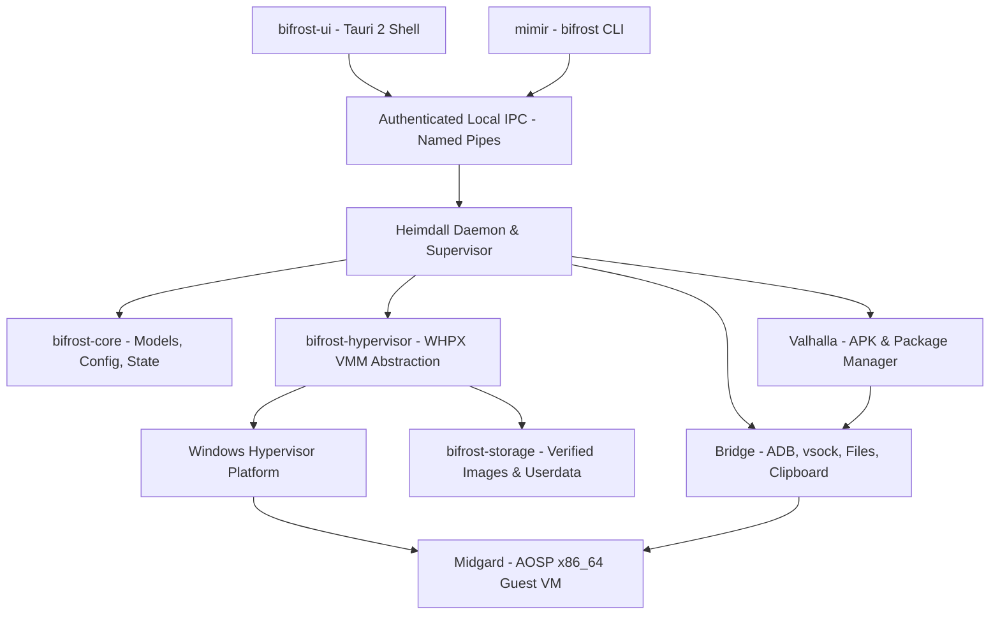

# 🌈 BIFRÖST

[](https://www.rust-lang.org/)
[-0078D4?style=flat-square&logo=windows11)](https://learn.microsoft.com/en-us/virtualization/api/)
[](https://source.android.com/)
[](https://learn.microsoft.com/en-us/virtualization/api/hypervisor-platform/hypervisor-platform)

**BIFRÖST** is an open-source, Rust-powered Android subsystem for Windows 11 designed to run real Android applications with deep native desktop integration — *"A Bridge Between Worlds."*

Inspired by Bifröst from Norse mythology and built as a modern, transparent, community-maintained successor to Microsoft's discontinued Windows Subsystem for Android (WSA), BIFRÖST is currently at **Milestone 3 (Midgard Prototype — Host Storage, WHPX Hypervisor & Runtime Stack Implemented; Live Android Boot Verification Pending)** and preparing for **Milestone 4 (Heimdall & Bridge)**.

> [!TIP]
> **Quick start (Milestone 3)**: Run tests, check Windows 11 WHPX readiness, or verify a Midgard image bundle:
> ```powershell
> $env:CARGO_TARGET_DIR = "C:\Users\johan\Proyectos\bifrost-target" # required with MinGW ld if repo path contains 'Ö'
> cargo test --workspace
> cargo run -p mimir -- doctor
> cargo run -p mimir -- runtime verify --image path\to\manifest.json
> ```

---

## 📖 Description

### What problem does it solve?
Following the discontinuation of Microsoft's Windows Subsystem for Android (WSA), Windows 11 users and developers lack an open-source, actively maintained, auditable way to run Android applications natively on Windows 11 — especially on **Windows 11 Home**, where the full Hyper-V management role is unavailable. Traditional emulators bundle monolithic single-window interfaces, opaque telemetry, or proprietary components.

### What does it do?
Once implemented across Milestones 1–8, BIFRÖST follows a modular runtime lifecycle:
1. **System verification (`mimir`)**: `bifrost doctor` inspects Windows 11 edition, CPU virtualization, `HypervisorPlatform` (WHPX), memory, disk space, and GPU capabilities.
2. **Runtime verification (`bifrost-storage`)**: Cryptographically verifies downloaded AOSP `x86_64` runtime images and attaches a persistent `userdata` virtual disk.
3. **Supervised VM execution (`heimdall` + `midgard`)**: Starts an unprivileged WHPX-accelerated Android `x86_64` VM with VirtIO storage, networking, `vsock`, and `virtio-gpu` (`gfxstream`) graphics.
4. **Windows ↔ Android bridge (`bridge`)**: Connects loopback-only ADB, clipboard sync, scoped shared folders, and notifications over authenticated local channels.
5. **Native package & window integration (`valhalla` + `bifrost-ui`)**: Installs/launches real APKs via Android `PackageManager`, projects independent per-app windows onto Windows 11 (Milestone 6), and provides a Fluent Design 2 management console (Milestone 7).

### Who is it for?
- **Windows 11 users** (Home, Pro, and Enterprise) who want clean, ad-free, open-source Android app execution.
- **Android and Rust systems developers** who need an inspectable, ADB-accessible, VirtIO-based Android subsystem on Windows.

---

## 📸 Screenshots

No UI screenshots exist yet because the project is at **Milestone 1 (`bifrost-core` & `mimir` CLI)**. Screenshots of `bifrost doctor`, Midgard boot, and `bifrost-ui` will be added to `docs/screenshots/` starting in Milestones 2, 3, and 7.

---

## ✨ Features

- **Modular Rust control plane (Planned M1–M4)**: Core domain models, state machine, daemon supervision (`heimdall`), and CLI (`mimir`) implemented natively in Rust with minimal `unsafe` code.
- **Windows 11 Home & Pro compatibility (Planned M2–M3)**: Targets Windows Hypervisor Platform (`WHPX`) behind a VMM-agnostic trait (`QEMU-WHPX` bring-up evolving to Rust `crosvm`), avoiding Pro-only Hyper-V dependencies.
- **Clean-room AOSP x86_64 foundation (Planned M3)**: Runs real, auditable AOSP Android 15/16 images with zero bundled Google Play Services or proprietary ARM translators.
- **Hardware-accelerated graphics pipeline (Planned M3–M6)**: Designed around `virtio-gpu` + `gfxstream` (with SwiftShader diagnostics fallback) and phased independent per-app Windows desktop windows via Android `VirtualDisplay`.
- **Security-by-default boundaries (Mandatory)**: Loopback-only ADB, user-SID authenticated Windows Named Pipes for local IPC, strict path traversal protection, and SHA-256 + signature verification for runtime images.
- **Transparent capability reporting (Mandatory)**: Unimplemented commands explicitly return `Unsupported` rather than simulating success.

---

## 🛠️ Technologies Used

- **Core & Control Plane (Planned M1+)**: Rust, Cargo workspaces, `tokio`, `serde`, `tracing`, `thiserror`, `anyhow`, `clap`, `windows` crate.
- **Virtualization & Android Guest (Planned M3+)**: Windows Hypervisor Platform (`WHPX`), AOSP `x86_64` (Android 15/16, GKI Linux kernel, VirtIO), `QEMU-WHPX` (Phase 1) → `crosvm` (target Rust VMM), `virtio-gpu` + `gfxstream`.
- **Desktop Application (Planned M7)**: Tauri 2 (Rust backend + WebView2 Fluent Design 2 UI) for the management shell; lightweight Rust Win32 + D3D12/Vulkan host windows for per-app displays (Milestone 6).
- **Testing & Quality Gates (Planned M1+)**: `cargo test`, `cargo clippy -- -D warnings`, `cargo fmt --check`.
- **Distribution (Planned M8)**: Signed Windows installer (MSIX / WiX) and cryptographically verified Midgard image manifests.

---

## 🏗️ Architecture

BIFRÖST separates presentation (`bifrost-ui`, `mimir`), supervision (`heimdall`), Windows ↔ Android communication (`bridge`, `valhalla`), and virtualization (`bifrost-hypervisor`, `midgard`) across strict security boundaries so no UI layer ever owns critical runtime logic.



For detailed component contracts, runtime boot sequences, and security boundaries, see [ARCHITECTURE.md](ARCHITECTURE.md).

---

## 📁 Project Structure

Current repository layout (Milestone 3 — only active crates are created):

```bash
BIFRÖST/
├── .gitignore                                     # Rust, Windows, disk images, logs, and secrets exclusions
├── Cargo.toml                                     # Cargo workspace manifest (unsafe_code = "deny")
├── Cargo.lock                                     # Reproducible dependency lockfile
├── ARCHITECTURE.md                                # Baseline system architecture, diagrams, and security boundaries
├── CHANGELOG.md                                   # Versioned project changelog
├── CLAUDE.md                                      # Engineering context, Git workflow, and documentation rules
├── CONTRIBUTING.md                                # Contribution guidelines, Git Flow, and Rust standards
├── README.md                                      # Project overview and documentation entry point
├── ROADMAP.md                                     # Incremental milestones (M0 to M8)
├── SECURITY.md                                    # Mandatory security invariants and vulnerability disclosure policy
├── master_prompt.md                               # Master engineering specification
├── android/
│   └── midgard/                                   # Midgard bundle documentation & manifest template
│       ├── README.md
│       └── manifest.example.json
├── crates/
│   ├── bifrost-core/                              # Shared domain models, state machine, TOML config, path security, logging
│   │   ├── Cargo.toml
│   │   └── src/
│   │       ├── lib.rs                             # #![forbid(unsafe_code)]
│   │       ├── capabilities.rs                    # FeatureStatus and VersionInfo models
│   │       ├── config.rs                          # Versioned TOML config & security/bounds validation
│   │       ├── error.rs                           # Structured BifrostError taxonomy
│   │       ├── logging.rs                         # Tracing subscriber setup
│   │       ├── paths.rs                           # Directory traversal guards & per-user path layout
│   │       └── state.rs                           # Deterministic RuntimeStateMachine
│   ├── bifrost-diagnostics/                       # Native Windows 11 & WHPX compatibility engine (`bifrost doctor`)
│   │   ├── Cargo.toml
│   │   └── src/
│   │       ├── lib.rs                             # Public diagnostics entrypoint
│   │       ├── model.rs                           # Serializable snapshot and doctor report models
│   │       ├── evaluator.rs                       # Pure compatibility rules & unit tests
│   │       ├── format.rs                          # Human-readable terminal report renderer
│   │       └── probe_windows.rs                   # Audited Win32, Registry, CPUID, WHPX, and DXGI probes
│   ├── bifrost-storage/                           # Verified Midgard image manifests & persistent userdata disks
│   │   ├── Cargo.toml
│   │   └── src/
│   │       ├── lib.rs                             # #![forbid(unsafe_code)]
│   │       ├── manifest.rs                        # Versioned bundle schema (direct_kernel & bootable_image)
│   │       ├── verify.rs                          # Streaming SHA-256 verification & root containment
│   │       └── disk.rs                            # Persistent userdata.img creation & guarded wipe
│   ├── bifrost-hypervisor/                        # VMM-agnostic WHPX abstraction & Phase 1 QEMU-WHPX backend
│   │   ├── Cargo.toml
│   │   └── src/
│   │       ├── lib.rs                             # #![forbid(unsafe_code)]
│   │       ├── backend.rs                         # HypervisorBackend trait, VmSpec, VmLaunchInfo
│   │       ├── qmp.rs                             # Pure-Rust loopback QMP client (system_powerdown)
│   │       └── qemu_whpx.rs                       # QEMU-WHPX arg builder, launch, and shutdown
│   ├── bifrost-runtime/                           # Midgard lifecycle orchestration, state persistence & log reader
│   │   ├── Cargo.toml
│   │   └── src/
│   │       ├── lib.rs                             # #![forbid(unsafe_code)]
│   │       ├── state_store.rs                     # Atomic runtime-state.json persistence
│   │       └── manager.rs                         # MidgardRuntime start/stop/restart/status/logs
│   └── mimir/                                     # Administrative CLI (`bifrost` binary)
│       ├── Cargo.toml
│       └── src/
│           ├── main.rs                            # #![forbid(unsafe_code)], exit codes (0 ok, 1 error, 2 unsupported)
│           ├── cli.rs                             # Clap CLI command and flag definitions
│           └── commands.rs                        # Command handlers (`version`, `status`, `config`, `doctor`, `runtime`, `logs`, stubs)
└── docs/
    ├── TECHNICAL_DECISIONS.md                     # Architecture Decision Record (ADR) index
    ├── decisions/
    │   ├── ADR-0001-aosp-x86-64-foundation.md     # AOSP x86_64 VirtIO / Cuttlefish alignment
    │   ├── ADR-0002-whpx-vmm-abstraction.md       # WHPX-first VMM abstraction (QEMU -> crosvm)
    │   ├── ADR-0003-graphics-and-windowing-strategy.md # virtio-gpu + gfxstream & phased windowing
    │   └── ADR-0004-arm64-compatibility-policy.md # Clean-room x86_64 policy & proprietary exclusions
    └── research/
        └── feasibility-report.md                  # Milestone 0 technical feasibility & host baseline report
```

---

## 💻 System Requirements

### Target User Host (Windows 11)
- **OS**: Windows 11 x64 (Home, Pro, or Enterprise).
- **CPU**: 64-bit x86_64 processor with hardware virtualization (`Intel VT-x` or `AMD-V`) and SLAT enabled in firmware.
- **Windows Feature**: **Windows Hypervisor Platform** (`HypervisorPlatform`) enabled (required starting in Milestone 3).
- **RAM**: 16 GB minimum recommended (4–8 GB allocated to Midgard).
- **GPU**: DirectX 12 / Vulkan-capable GPU (Intel Arc, AMD Radeon, or NVIDIA GeForce) for `gfxstream` hardware acceleration.

### Development Host (Milestone 1+)
- `git` (`2.56.1` verified on host).
- `rustup` (`1.29.3`) with `rustc 1.100.0`, `cargo 1.100.0`, `rustfmt`, and `clippy`.
- Linker toolchain: either **WinLibs MinGW-w64 UCRT** (`stable-x86_64-pc-windows-gnu`, portable user-space install) or **Visual Studio 2022 C++ Build Tools** (`stable-x86_64-pc-windows-msvc`, requires elevated installer).
- *(Milestone 3+)* `qemu-system-x86_64` (or `crosvm` Windows build) and Android `adb` platform-tools.
- *(Building custom AOSP images)* Dedicated Linux x86_64 build host with 64 GB RAM and 300–400 GB free NVMe SSD.

---

## ⚙️ Installation and Setup

1. **Clone the repository and switch to `develop`**:
   ```bash
   git clone <repository-url>
   cd BIFRÖST
   git checkout develop
   ```
2. **Install Rust and a Windows C/linker toolchain**:
   ```powershell
   winget install Rustlang.Rustup
   # Option A (no admin required — GNU UCRT toolchain):
   winget install BrechtSanders.WinLibs.POSIX.UCRT
   rustup default stable-x86_64-pc-windows-gnu
   # Option B (elevated PowerShell — MSVC toolchain):
   # winget install Microsoft.VisualStudio.2022.BuildTools
   ```
3. **Enable Windows Hypervisor Platform (required before Milestone 3, elevated PowerShell)**:
   ```powershell
   DISM /Online /Enable-Feature /FeatureName:HypervisorPlatform /All
   ```
4. **Environment & secrets**: Never commit `.env` files, signing keys (`*.key`, `*.pem`, `*.pfx`), runtime images (`*.img`, `*.qcow2`), or APKs to the repository (enforced in `.gitignore`).

---

## 🚀 Usage and Execution

### Development & Local Execution (Milestone 1)
When building with MinGW (`stable-x86_64-pc-windows-gnu`) inside a folder containing non-ASCII characters (`BIFRÖST`), point `CARGO_TARGET_DIR` to an ASCII path:

```powershell
$env:CARGO_TARGET_DIR = "C:\Users\johan\Proyectos\bifrost-target"
cargo test --workspace
cargo run -p mimir -- version
cargo run -p mimir -- config init
cargo run -p mimir -- config validate
cargo run -p mimir -- status
```

### CLI & Verification Commands

| Command | Description | Status |
|---|---|---|
| `cargo fmt --all -- --check` | Verify Rust code formatting across workspace | **Implemented** |
| `cargo clippy --workspace --all-targets -- -D warnings` | Run strict Clippy static analysis | **Implemented** |
| `cargo test --workspace` | Execute unit tests (`31` tests across 6 workspace crates) | **Implemented** |
| `bifrost version [--json]` | Display BIFRÖST version, host target, and capability maturity | **Implemented** |
| `bifrost status [--json]` | Display reconciled Midgard runtime state and Heimdall connection status | **Implemented** |
| `bifrost config init \| show \| validate` | Initialize, inspect, and validate `bifrost.toml` | **Implemented** |
| `bifrost doctor [--strict] [--json]` | Inspect Windows 11 edition, CPU, virtualization, WHPX, RAM, storage, and GPU | **Implemented** |
| `bifrost runtime start \| stop \| restart \| verify` | Verify image SHA-256 digests and manage Midgard WHPX VM lifecycle | **Partially implemented** |
| `bifrost logs [--tail N]` | Inspect Midgard serial console and VMM stderr logs | **Implemented** |
| `bifrost devices` | List Bridge/ADB devices | Planned (M4) |
| `bifrost install <app.apk>` / `uninstall` / `apps list` | Validate and manage APKs via Valhalla | Planned (M5) |

---

## 📦 Deployment and Distribution

Distribution packaging is planned for **Milestone 8**:
- Host binaries (`bifrost.exe`, `heimdall.exe`, `bifrost-ui`) will ship via a signed Windows installer (MSIX / WiX).
- Midgard Android `x86_64` runtime images will be built reproducibly on Linux CI runners and published as separate, versioned bundles accompanied by SHA-256 checksums and Ed25519 signatures.
- No proprietary Google Play Services, GApps, `libhoudini`, or `libndk_translation` binaries will ever be distributed.

---

## 🔬 Technical Architecture & Decisions

### Architecture Decision Records

| ADR | Decision | Status |
|---|---|---|
| [ADR-0001](docs/decisions/ADR-0001-aosp-x86-64-foundation.md) | Use AOSP `x86_64` (Android 15/16, VirtIO / Cuttlefish-aligned) built in Linux CI | Accepted |
| [ADR-0002](docs/decisions/ADR-0002-whpx-vmm-abstraction.md) | Target WHPX behind a Rust `HypervisorBackend` trait (`QEMU-WHPX` → `crosvm`) | Accepted |
| [ADR-0003](docs/decisions/ADR-0003-graphics-and-windowing-strategy.md) | Use `virtio-gpu` + `gfxstream` and phased windowing (single display → per-app `VirtualDisplay`) | Accepted |
| [ADR-0004](docs/decisions/ADR-0004-arm64-compatibility-policy.md) | Maintain clean-room `x86_64` baseline; prohibit proprietary ARM translators and GApps | Accepted |

### Capability Matrix

| Area | Status | Notes |
|---|---|---|
| Feasibility research, architecture, ADRs | **Implemented** | Completed in Milestone 0 |
| `bifrost-core` (state, config, paths, errors, logging) | **Implemented** | Completed in Milestone 1 (`12` unit tests passing) |
| `bifrost-diagnostics` (`bifrost doctor`) | **Implemented** | Completed in Milestone 2 (`4` evaluator tests + live Windows 11 Home WHPX verification) |
| `bifrost-storage`, `bifrost-hypervisor`, `bifrost-runtime` | **Partially implemented** | Host stack & `9` unit tests passing; live Android `x86_64` WHPX boot gate pending QEMU UAC install + verified bundle |
| `mimir` CLI (`version`, `status`, `config`, `doctor`, `runtime`, `logs`) | **Partially implemented** | Core, doctor, runtime, and log commands live (`6` tests); Bridge/Valhalla commands return `Unsupported` |
| Heimdall daemon, authenticated IPC, loopback ADB | **Planned** | Milestone 4 |
| Valhalla real APK management | **Planned** | Milestone 5 |
| Independent per-app Windows desktop windows | **Planned / Experimental** | Milestone 6 |
| ARM64 binary translation (`arm64-v8a` native APKs) | **Unsupported** | Independent clean-room research only |

---

## 🗺️ Roadmap

- [x] **Milestone 0**: Research, host baseline inspection, feasibility report, architecture, and ADRs.
- [x] **Milestone 1**: Cargo workspace, `bifrost-core`, and `mimir` CLI foundation.
- [x] **Milestone 2**: Native Windows 11 compatibility diagnostics (`bifrost doctor`).
- [ ] **Milestone 3**: Minimal functional Midgard Android `x86_64` VM prototype on WHPX.
- [ ] **Milestone 4**: Heimdall supervisor daemon, authenticated local IPC, and Bridge (ADB / `vsock`).
- [ ] **Milestone 5**: Valhalla real Android package management (`install`, `uninstall`, `apps list`, launch).
- [ ] **Milestone 6**: Shared directories, clipboard, notifications, networking, and per-app Windows desktop windows.
- [ ] **Milestone 7**: Windows 11 Fluent Design desktop application (`bifrost-ui`).
- [ ] **Milestone 8**: Signed installer, verified runtime image updates, and recovery tooling.

See [ROADMAP.md](ROADMAP.md) for detailed milestone exit criteria.

---

## 🤝 Contributors

| Contributor | Commits |
|---|---:|
| Johan Rodríguez | 23 |

---

## 📚 References

<details>
<summary>Click to expand upstream technical references</summary>

- [Android Open Source Project (AOSP) — Cuttlefish Virtual Device](https://source.android.com/docs/devices/cuttlefish)
- [Microsoft — Windows Hypervisor Platform (WHPX) API](https://learn.microsoft.com/en-us/virtualization/api/hypervisor-platform/hypervisor-platform)
- [crosvm — ChromeOS Virtual Machine Monitor (Rust)](https://crosvm.dev/book/)
- [QEMU — Windows Hypervisor Platform (WHPX) & VirtIO-GPU](https://www.qemu.org/docs/master/)
- [Waydroid — Container-based Android on Linux (Architectural Reference)](https://waydro.id/)
- [Bliss OS — Android-x86 Desktop Reference](https://blissos.org/)

</details>

---

## ✍️ Author

Johan Rodríguez
